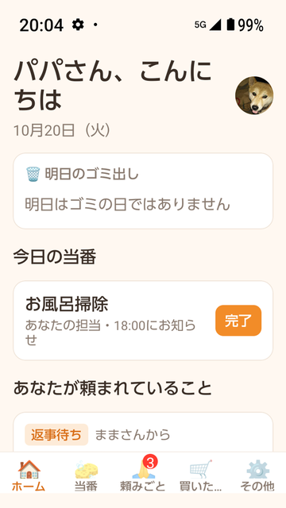
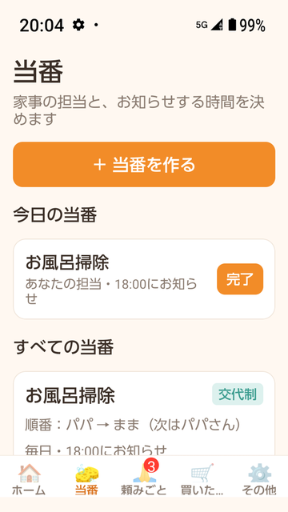
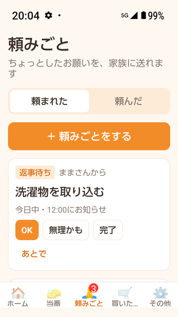
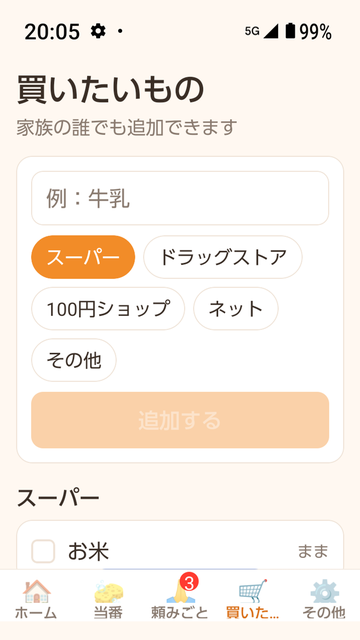
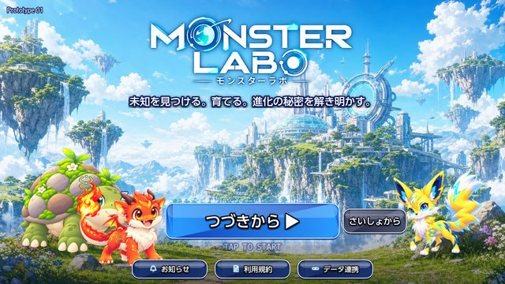
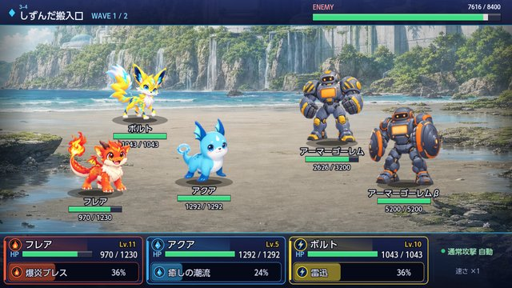

# Smart Labo（株式会社スマートラボ）

AI（Claude Code・Codex・ChatGPT）を開発パートナーにして、**企画からストア公開・本番運用まで一人で形にする**バイブコーダーです。
スマホアプリ、Webサービス、ホームページを作っています。

- 🌐 会社サイト：https://smartlaboworks.com/
- ✉️ お問い合わせ：info@smartlaboworks.com

---

## 🛠 できること

| 分野 | 使っている技術 |
|---|---|
| スマホアプリ | Expo（React Native）、TypeScript、Expo Router、EAS Build |
| バックエンド | Firebase（Authentication・Firestore・Storage・Cloud Functions）、Node.js / Express |
| Web | React、Vite、HTML / CSS / JavaScript、GitHub Pages |
| ゲーム | Phaser 3、Capacitor（Web ゲームを Android / iOS アプリに） |
| AI 組み込み | OpenAI API、Claude API、画像からの文字読み取り（OCR） |
| 運用 | VPS での本番運用、Google Play への公開と審査対応、AdMob 広告 |

---

## 📱 作品

### カジまる — 家族で家事を共有するアプリ（Google Play で公開中）
家事の分担と「やったよ」を家族で共有する Android アプリ。企画・デザイン・開発・ストア審査まで担当。
- 家族グループと招待 QR コード、家事の割り当てと通知、アイコン写真の家族共有
- Expo（React Native）＋ Firebase（認証・データベース・ストレージ・Cloud Functions）、AdMob 広告
- 🔗 [Google Play](https://play.google.com/store/apps/details?id=com.smartlaboworks.kajimaru)

  
  
  
  

### MONSTER LABO（モンスターラボ）— モンスター育成バトルゲーム（Google Play で公開中）
3体のモンスターで戦う、半自動リアルタイムバトルのスマホゲーム。
- 育成・通常進化と特殊進化・図鑑、ボスのレーザーに合わせて防壁を張るなどの駆け引き
- ゲームバランスを自動の戦闘シミュレーションで検証（自動テスト 100 本以上）
- 新しい章をアプリ更新なしで配信する仕組み、Google Play 課金（サーバーで購入を確認、未成年の月額上限。現在審査中）
- Phaser 3 ＋ TypeScript ＋ Vite、Capacitor で Android / iOS アプリ化、Firebase、AdMob
- 🔗 [Google Play](https://play.google.com/store/apps/details?id=jp.smartlabo.monsterlabo)

  
  
  
  

### Smart Labo Works ライト — 中小企業向け AI 業務支援サービス（本番運用中）
「全社員に、AIという戦力を。」をコンセプトにした業務支援 Web サービス。
- AI 会議（議事録の作成・要約）、資料の読み込み（PDF・Word・Excel）、サロン向け予約・顧客管理アプリ
- React ＋ Vite ＋ Node.js / Express、VPS で本番運用、自動テスト 60 本以上
- 不動産会社向けの試作版を開発し、実際の業務で使ってもらいながら改善
- ※ 商用のためソースコードは非公開です。画面はご依頼に応じてデモでご覧いただけます

### Study Start — 資格試験の学習アプリ（試作品）
教材の写真や PDF を取り込み、「START を押せば授業が始まる」学習アプリ。
- 写真から教材登録、AI による目次の読み取りと仕分け、データはブラウザ内だけに保存
- 🔗 [ソースコード](https://github.com/smartlabosukimagakusyuu-dev/study-ai-mvp) ／ [デモ](https://smartlabosukimagakusyuu-dev.github.io/study-ai-mvp/)

### 会社ホームページ
自社サービスの紹介サイト。デザインから公開まで担当。
- HTML / CSS / JavaScript、GitHub Pages で自動公開
- 🔗 [サイト](https://smartlaboworks.com/) ／ [ソースコード](https://github.com/smartlabosukimagakusyuu-dev/smartlabo-website)

### 開発中
- **AI ダイエットアプリ** — 3方向セルフタイマー撮影、体の変化の動画書き出し、AI コーチとの面談形式の相談（Expo ＋ Firebase Functions ＋ OpenAI）
- **ReShot** — 施工やサロン向けの Before / After 写真アプリ。比較画像、PDF 報告書の作成（Expo）

---

## 🤖 AI との開発スタイル
- 仕様書を先に書き、AI に実装を任せ、実機（Android）で一つずつ確かめながら進めます
- プロジェクトごとに AI 向けのルール（`AGENTS.md` など）を用意して、品質と方針をそろえています
- 公開前には、秘密情報や個人情報が入っていないかを必ず確認します
